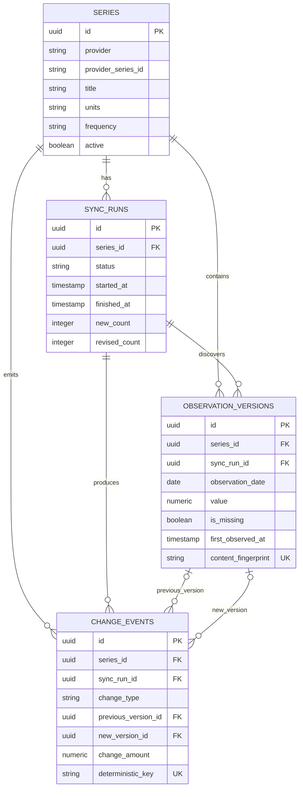

# Database Design and Migrations

## Purpose

MacroMonitor must preserve economic values that are later revised. Observation rows are therefore append-only: a new provider value creates a new version instead of updating or deleting the earlier value.

## Phase 2 schema



## Important invariants

### Provider identity

`series(provider, provider_series_id)` is unique. The same FRED series cannot be registered twice.

### Append-only versions

Every observation version has a deterministic content fingerprint. The database rejects a repeated fingerprint, while different values for the same series and period remain valid separate rows.

### Missing values

The schema enforces:

```text
is_missing = true  -> value is null
is_missing = false -> value is not null
```

A provider's missing marker is never converted to zero.

### Decimal precision

Economic values and revision amounts use `NUMERIC(30, 10)` in PostgreSQL and `Decimal` in Python. This avoids false revisions caused by binary floating-point rounding.

### Sync state

A running sync has no finish time. A succeeded or failed sync must have one. All classification counts must be nonnegative.

### Immutable change identity

Each meaningful change has a deterministic key. This is the future foundation for idempotent event and notification processing.

## Transaction ownership

Repositories call `flush()` so IDs and constraints are available immediately, but they never call `commit()`. The application service owns the transaction boundary.

The future synchronization service will perform this as one transaction:

```text
new observation versions
        +
change events
        +
sync-run final state and counts
        +
series metadata update
```

If any write fails, the entire transaction rolls back.

## Query-oriented indexes

- Sync history by series and start time.
- Observation history by series, economic period, and first-observed time.
- Change history by series and occurrence time.
- Unique observation fingerprint.
- Unique change-event deterministic key.

Indexes will be changed only in response to measured query plans and latency.

## Migration workflow

Apply migrations:

```bash
alembic upgrade head
```

Inspect the revision:

```bash
alembic current
```

Check whether ORM metadata differs from the migrated schema:

```bash
alembic check
```

Generate reviewable SQL without modifying a database:

```bash
alembic upgrade head --sql
```

CI starts an empty PostgreSQL database, applies the full migration chain, checks for drift, runs integration tests, downgrades to the base revision, and upgrades again.
