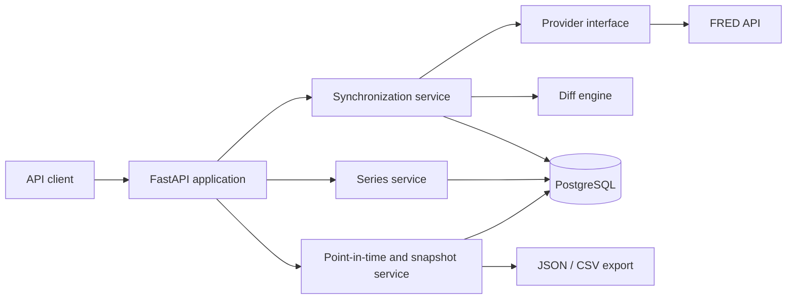
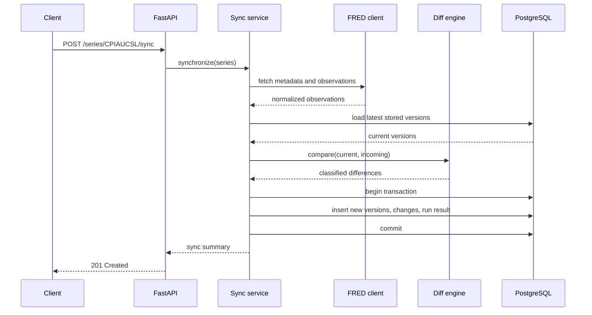
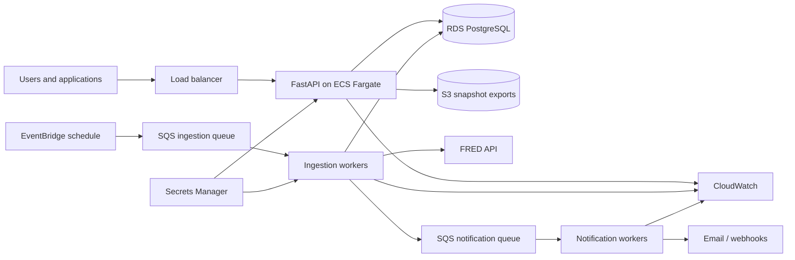

# System Design

## 1: Requirements

### 1.1 Functional requirements

The system must:

1. Maintain a catalog of tracked economic series and their metadata.
2. Retrieve observations and vintage metadata from FRED.
3. Store every materially different version of an observation instead of overwriting old values.
4. Compare each provider response with the latest stored version.
5. Classify observations as `new`, `revised`, `unchanged`, or `missing`.
6. Record synchronization runs and the changes detected in each run.
7. Return the revision history of a series for a particular economic period.
8. Reconstruct the observations known by the system at an `as_of` timestamp.
9. Create immutable, multi-series snapshots using exact observation versions.
10. Export snapshots as JSON and CSV with metadata and a SHA-256 checksum.
11. Provide deterministic fixture data that demonstrates a release and revision even when live data has not changed.

After the MVP, the system should also:

12. Authenticate users and support user-owned watchlists.
13. Send signed webhook or email notifications for watched changes.
14. Retry failed deliveries and retain an audit history.
15. Run ingestion automatically on a schedule.
16. Support additional providers through the same provider interface.

### 1.2 Non-functional requirements

| Area | Requirement |
|---|---|
| Correctness | Decimal-safe comparisons; point-in-time queries must not leak later data. |
| Idempotency | Processing the same provider response twice must not create duplicate versions or changes. |
| Consistency | A synchronization run, its observation versions, and its changes are committed atomically. |
| Availability | The API remains usable for stored data when FRED is temporarily unavailable. |
| Reliability | Provider calls use timeouts and bounded retries; failures are recorded without partial writes. |
| Performance | Common reads remain responsive with at least one million observation-version rows. |
| Scalability | API and workers can scale independently; ingestion work can later be distributed by series. |
| Reproducibility | A snapshot remains unchanged after later revisions and has deterministic canonical content. |
| Security | Secrets stay outside source control; inputs are validated; later webhooks are signed. |
| Observability | Structured logs, run status, latency, error counts, and notification failures are visible. |
| Maintainability | Provider-specific code is isolated behind an interface and schema changes use migrations. |
| Testability | Business logic can run against fixtures without FRED, AWS, or a network connection. |

### 1.3 Scope boundary

The MVP is a local, API-first service with FRED, FastAPI, PostgreSQL, manual synchronization, revision history, point-in-time queries, and snapshots.

Authentication, watchlists, notifications, scheduled jobs, AWS, extra providers, and a frontend are later stages. This boundary prevents the first release from becoming an unfinished distributed system.

## 2: Core items

### 2.1 Core domain objects

#### Series

Describes a provider dataset such as `CPIAUCSL`.

Important fields:

- internal ID;
- provider and provider series ID;
- title, units, and frequency;
- active status;
- provider metadata;
- last successful synchronization time.

#### Observation version

An append-only record of a value observed for one series and economic period.

Important fields:

- series ID and observation period;
- decimal value or explicit missing status;
- provider realtime/vintage dates;
- first-observed timestamp;
- content fingerprint;
- source sync-run ID.

The latest row is not the only truth. Older rows are deliberately retained.

#### Sync run

Represents one attempt to retrieve and process a series.

Important fields:

- series ID;
- status: `running`, `succeeded`, or `failed`;
- start and finish timestamps;
- provider request identifier when available;
- counts for new, revised, unchanged, and missing observations;
- sanitized error details.

#### Change

Explains how one economic period differed during a sync run.

Important fields:

- sync-run ID and period;
- type: `new`, `revised`, or `missing`;
- previous and new observation-version IDs;
- signed and absolute numeric change.

Unchanged observations contribute to run counts but do not need individual change rows.

#### Snapshot and snapshot item

A snapshot stores selection criteria, creation metadata, format version, and checksum. Snapshot items reference the exact observation-version rows selected for each series and period.

This reference-based design prevents later revisions from changing an existing snapshot.

### 2.2 Core application components

1. **FastAPI application** — validates requests and exposes the REST API.
2. **Series service** — manages the configured series catalog.
3. **Provider client** — fetches and normalizes FRED responses.
4. **Synchronization service** — coordinates retrieval, comparison, and persistence.
5. **Diff engine** — classifies normalized observations without knowing about HTTP or database details.
6. **Repository layer** — performs transactional PostgreSQL reads and writes.
7. **Point-in-time query service** — selects the newest version known on or before `as_of`.
8. **Snapshot service** — freezes selected versions, serializes canonical content, and calculates checksums.
9. **Export service** — streams JSON and CSV representations of a snapshot.
10. **Worker and queue, later** — execute scheduled ingestion and notification delivery outside API requests.

### 2.3 Core technology choices

| Concern | Choice | Reason |
|---|---|---|
| API | FastAPI + Pydantic | Typed validation, OpenAPI generation, and a strong Python ecosystem. |
| Database | PostgreSQL | Transactions, constraints, indexing, JSON metadata, and robust historical queries. |
| ORM/migrations | SQLAlchemy + Alembic | Explicit persistence model and repeatable schema evolution. |
| Provider access | HTTP client behind a protocol | Keeps FRED-specific response formats out of business logic. |
| Numeric values | PostgreSQL `NUMERIC` and Python `Decimal` | Avoids false revisions caused by floating-point rounding. |
| Local runtime | Docker Compose | Reproducible API and database startup. |
| Tests | pytest with fake provider fixtures | Revisions can be demonstrated deterministically and offline. |
| Later async work | SQS + worker | Decouples ingestion and notification retries from API traffic. |

## 3: APIs

All routes are versioned under `/api/v1`. Timestamps use ISO 8601 UTC values. Collection routes are paginated and errors use one consistent envelope.

### 3.1 MVP endpoints

| Method and route | Purpose |
|---|---|
| `GET /health` | Report service and database health. |
| `GET /api/v1/series` | List tracked series. |
| `GET /api/v1/series/{series_id}` | Return series metadata. |
| `POST /api/v1/series/{series_id}/sync` | Trigger a manual synchronization. |
| `GET /api/v1/series/{series_id}/sync-runs` | List synchronization history. |
| `GET /api/v1/sync-runs/{run_id}` | Return status and summary counts. |
| `GET /api/v1/sync-runs/{run_id}/changes` | Return new and revised observations. |
| `GET /api/v1/series/{series_id}/revisions?period=YYYY-MM-DD` | Return every known version for a period. |
| `GET /api/v1/series/{series_id}/observations?as_of=...` | Return point-in-time observations. |
| `POST /api/v1/snapshots` | Create an immutable snapshot. |
| `GET /api/v1/snapshots/{snapshot_id}` | Return snapshot metadata and items. |
| `GET /api/v1/snapshots/{snapshot_id}/export?format=json` | Export JSON. |
| `GET /api/v1/snapshots/{snapshot_id}/export?format=csv` | Export CSV. |

Example snapshot request:

```json
{
  "series_ids": ["CPIAUCSL", "UNRATE", "FEDFUNDS"],
  "as_of": "2020-01-01T00:00:00Z",
  "observation_start": "2015-01-01",
  "observation_end": "2019-12-31"
}
```

Example change response:

```json
{
  "sync_run_id": "01JREVISIONEXAMPLE",
  "series_id": "GDP",
  "changes": [
    {
      "type": "new",
      "period": "2026-07-01",
      "previous_value": null,
      "new_value": "2.1",
      "change": null
    },
    {
      "type": "revised",
      "period": "2026-04-01",
      "previous_value": "1.8",
      "new_value": "1.6",
      "change": "-0.2"
    }
  ]
}
```

Decimals are encoded as strings at the API boundary so clients do not silently lose precision.

### 3.2 API behavior

- `POST /sync` returns `201 Created` after a synchronous MVP run. A later queued implementation can return `202 Accepted` without changing the resource model.
- A caller-supplied `Idempotency-Key` is accepted on mutation endpoints.
- Invalid dates, ranges, formats, and series IDs return `422` or `404` with machine-readable error codes.
- Collection endpoints use an opaque cursor plus a bounded `limit` rather than unbounded responses.
- Snapshot creation returns an existing snapshot when the same owner, selection criteria, and content already exist.
- Exports include a schema/format version so future readers can interpret older files.

### 3.3 Later endpoints

```text
POST   /api/v1/watchlists
GET    /api/v1/watchlists/{watchlist_id}
POST   /api/v1/webhook-subscriptions
GET    /api/v1/webhook-subscriptions/{subscription_id}/deliveries
POST   /api/v1/deliveries/{delivery_id}/retry
```

These routes require authentication and ownership checks; they are not part of the MVP.

## 4: High-level design

### 4.1 MVP architecture



The MVP performs a manual synchronization within the API process. This is simpler to build and debug. Its interfaces are designed so the synchronization service can later run unchanged inside a worker.

### 4.2 Synchronization data flow



### 4.3 Production evolution



Scheduled work is queued by series. API instances, ingestion workers, and notification workers can scale independently. Failed jobs move to dead-letter queues for inspection and replay.

## 5: Deep dive into non-functional requirements

### 5.1 Correct version history and temporal semantics

The system distinguishes three times:

1. **Observation period** — the month, quarter, or date the economic value describes.
2. **Provider vintage/realtime date** — when the provider says that version was valid.
3. **First observed at** — when this platform retrieved that version.

They must not be collapsed into one timestamp. Point-in-time queries initially mean “known by this platform at `as_of`,” using `first_observed_at`. Provider vintage dates remain available for provider-defined historical analysis.

For each `(series_id, observation_period)`, the query selects the version with the greatest `first_observed_at` that is less than or equal to `as_of`. A covering index beginning with series, period, and descending observation time supports this access pattern.

### 5.2 Idempotency and duplicate prevention

Each normalized observation receives a fingerprint from stable fields such as provider, series ID, period, normalized value/missing state, and provider vintage dates.

A unique database constraint on the natural version identity or fingerprint prevents duplicate versions even if application checks race. Sync writes use `INSERT ... ON CONFLICT`-style behavior where appropriate.

For API retries, an `Idempotency-Key` record stores the request fingerprint and completed resource ID. Reusing the same key with different request content is rejected.

Later, queued jobs have deterministic job identities such as `(series_id, scheduled_window)`. SQS may deliver a message more than once, so workers remain idempotent instead of assuming exactly-once delivery.

### 5.3 Transactional consistency and concurrency

One database transaction contains:

- newly discovered observation versions;
- change rows;
- snapshot-independent series metadata updates; and
- the final successful sync-run status and counts.

If any write fails, all these changes roll back. Provider network calls happen before opening the transaction so a slow API does not hold database locks.

Only one active sync per series should compare and commit at a time. The MVP can use a PostgreSQL advisory lock or locked series row. Later workers retain the same database-level protection because queue visibility alone cannot prevent every race.

### 5.4 Reliable provider integration

Provider calls have connection and response timeouts. Retries are limited to transient failures such as timeouts, `429`, and selected `5xx` responses, with exponential backoff and jitter. Authentication failures and invalid series IDs are not retried blindly.

The service records a failed sync run with a sanitized error category. Previously stored reads and snapshot exports remain available during a FRED outage.

A circuit breaker is unnecessary for the MVP. It becomes useful only if repeated provider failures consume worker capacity in production.

### 5.5 Query performance and growth

Likely indexes include:

- unique provider plus provider series ID on `series`;
- series, period, and descending first-observed time on `observation_versions`;
- series and descending start time on `sync_runs`;
- sync-run ID and type on `changes`;
- snapshot ID on `snapshot_items`.

The API uses keyset/cursor pagination for large histories. Snapshot exports are streamed rather than loaded entirely into memory.

Partitioning is not an MVP requirement. If measured table and index growth justifies it, `observation_versions` can later be partitioned by series hash or observation year without changing domain behavior. Read replicas and caching are similarly measurement-driven later optimizations.

### 5.6 Deterministic snapshots and checksums

Snapshot creation runs in a transaction with a stable database view. It stores exact observation-version IDs rather than a query that could return different results later.

Checksum input uses a documented canonical JSON representation:

- fixed schema version;
- UTF-8 encoding;
- lexicographically sorted series and chronological observations;
- normalized decimal strings;
- normalized UTC timestamps;
- explicit `null` values where required; and
- no non-deterministic fields such as export time.

The SHA-256 checksum covers the canonical dataset and required metadata. JSON and CSV are presentation formats; the same canonical logical content is used for verification.

### 5.7 Security

The FRED key and database password come from environment variables locally and Secrets Manager in production. Logs must redact credentials, authorization headers, webhook secrets, and potentially sensitive URLs.

Inputs use allow-listed formats and bounded sizes. SQLAlchemy parameterization prevents string-built SQL. Export filenames and response headers are generated by the service rather than copied from arbitrary user input.

Later authentication uses short-lived tokens and ownership checks on watchlists, snapshots, and webhook subscriptions. Webhooks are signed with an HMAC secret, include a timestamp and event ID, and document replay protection.

### 5.8 Availability and graceful degradation

The database is the system of record. The API can serve catalog, history, point-in-time, and snapshot reads when FRED is down. Only new synchronization is impaired.

Production deployments use multiple stateless API tasks across availability zones and managed PostgreSQL backups. Queues absorb temporary downstream outages. Notification failure does not roll back already committed economic data.

Recovery goals should be chosen before deployment rather than invented afterward. A reasonable initial portfolio target is an RPO of 24 hours and an RTO of 4 hours, then tightened if real users require it.

### 5.9 Observability and operations

Every request and job carries a correlation ID. Structured logs include series ID, sync-run ID, snapshot ID, duration, outcome, and error category, but not secrets or full provider payloads.

Important metrics include:

- synchronization success and failure counts;
- provider latency and rate-limit responses;
- new and revised observation counts;
- queue age and dead-letter count;
- webhook success rate and retry count;
- API latency and error rate; and
- database connection and query latency.

Alerts should focus on user impact: repeated ingestion failures, stale critical series, old queued work, dead-letter messages, and sustained API errors. A runbook explains diagnosis and safe replay.

### 5.10 Testing strategy

The diff engine and canonical serializer receive fast unit tests covering new, revised, unchanged, missing, precision, ordering, and boundary-time cases.

PostgreSQL integration tests verify unique constraints, transactions, locks, and point-in-time queries. API tests verify schemas, pagination, status codes, and idempotency. Recorded/fake provider fixtures make CI independent of live FRED availability.

A smaller number of end-to-end tests start the service and database, execute two fixture releases, verify the revision through HTTP, create a snapshot, and validate its checksum. Production smoke tests remain read-only except for a dedicated test series or account.
