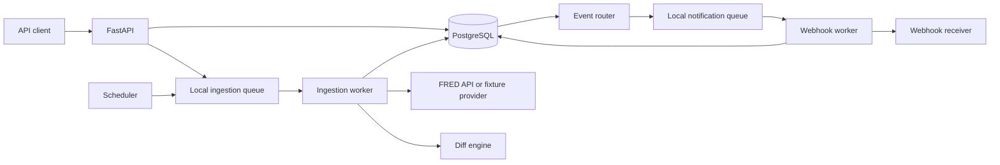
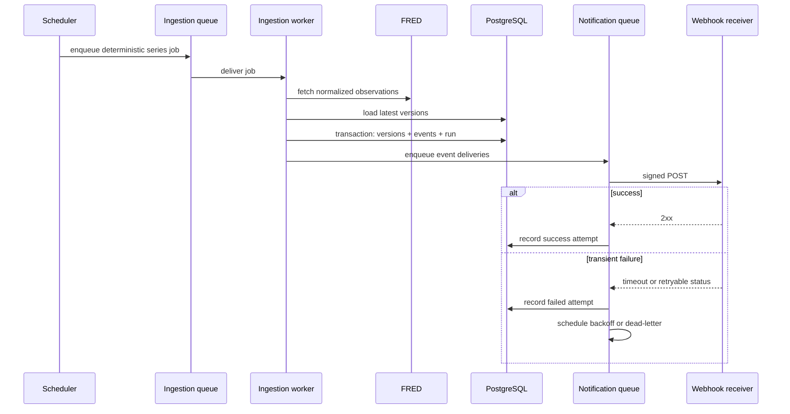
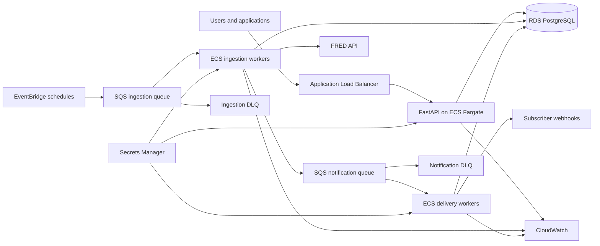

# MacroMonitor System Design

## 1: Requirements

### 1.1 Functional requirements

MacroMonitor must:

1. Maintain a catalog of supported FRED economic series.
2. Let users organize selected series into watchlists.
3. Retrieve provider data manually and on a schedule.
4. Preserve every materially different observation version.
5. Detect new, revised, unchanged, removed, and missing observations.
6. Record immutable change events and synchronization history.
7. Expose series, revisions, watchlists, runs, and events through a REST API.
8. Let developers subscribe HTTPS webhooks to a watchlist.
9. Deliver signed event payloads asynchronously.
10. Retry transient delivery failures and retain every attempt.
11. Dead-letter exhausted work and support safe replay.
12. Remain idempotent when API requests, jobs, or queue messages are repeated.
13. Authenticate users and enforce ownership before public deployment.

### 1.2 Non-functional requirements

| Area | Requirement |
|---|---|
| Correctness | Decimal-safe comparison and explicit missing/removed semantics. |
| Idempotency | Repeated provider input or queue delivery produces no duplicate logical records or notifications. |
| Consistency | Versions and change events from one sync commit atomically. |
| Reliability | Provider and webhook failures use bounded retries and auditable terminal states. |
| Availability | Stored history remains readable while FRED or webhook receivers are unavailable. |
| Performance | Common reads remain responsive with at least one million version rows. |
| Scalability | API, ingestion workers, and delivery workers scale independently. |
| Security | Secrets remain external, ownership is enforced, and webhook payloads are signed. |
| Observability | Logs and metrics trace work from schedule through webhook attempt. |
| Maintainability | Provider, queue, and delivery implementations remain behind interfaces. |
| Testability | The complete workflow runs against deterministic local fixtures. |

### 1.3 Scope

The product MVP includes FRED, watchlists, version history, revision detection, asynchronous scheduling, signed webhooks, retries, delivery history, and safe replay.

The production release adds authentication and AWS operation. Email, other providers, a frontend, research snapshots, and quantitative analysis are optional extensions.

## 2: Core items

### 2.1 Domain objects

#### User

Owns watchlists and webhook subscriptions. Users and ownership enforcement are introduced before public deployment.

#### Series

Represents a provider dataset such as `CPIAUCSL`. It stores provider identity, title, units, frequency, active status, metadata fingerprint, and last successful sync time.

#### Watchlist and watchlist membership

A watchlist is a named collection of series selected for monitoring. Membership prevents duplicates and allows one series to belong to many watchlists.

#### Observation version

An append-only record containing a series, economic period, decimal value or missing state, provider vintage dates, first-observed time, content fingerprint, and source sync run.

#### Sync run

One attempt to retrieve and process a series, including state, timing, counts, provider metadata, and sanitized failure information.

#### Change event

An immutable meaningful difference with an event ID, series, period, type, previous and new version IDs, revision amount, metadata changes, timestamp, and source sync run.

Unchanged observations contribute to run counts but do not create notification events.

#### Webhook subscription

Associates a watchlist with a callback URL, event filters, status, and secret reference used for HMAC signing.

#### Delivery and delivery attempt

A delivery is the logical pairing of a change event and subscription. Delivery attempts record each HTTP request, status, duration, next retry time, and sanitized error.

Separating logical deliveries from attempts makes retries observable without duplicating events.

### 2.2 Application components

1. **FastAPI application** — validation, authentication, REST resources, and OpenAPI.
2. **Series service** — catalog and provider metadata.
3. **Watchlist service** — ownership and monitored-series membership.
4. **Provider client** — retrieves and normalizes FRED data.
5. **Synchronization service** — coordinates fetch, comparison, and persistence.
6. **Diff engine** — pure classification logic independent of HTTP and storage.
7. **Repository layer** — transactional PostgreSQL access.
8. **Scheduler** — identifies active watched series that are due.
9. **Ingestion queue and workers** — execute synchronization outside API requests.
10. **Event router** — maps change events to relevant subscriptions.
11. **Notification queue and workers** — deliver webhooks and schedule retries.
12. **Operations layer** — logs, metrics, dead-letter inspection, and replay.

### 2.3 Technology choices

| Concern | Choice | Reason |
|---|---|---|
| API | FastAPI + Pydantic | Typed validation and generated OpenAPI. |
| Database | PostgreSQL | Transactions, constraints, indexes, and historical queries. |
| Persistence | SQLAlchemy + Alembic | Explicit model and repeatable migrations. |
| Numeric values | Python `Decimal` + PostgreSQL `NUMERIC` | Prevent false revisions from floating-point error. |
| Local runtime | Docker Compose | Reproducible API, workers, and database. |
| Local jobs | Queue abstraction with a lightweight local backend | Develop and test without AWS. |
| Production jobs | EventBridge + SQS | Scheduling, buffering, redelivery, and dead-letter support. |
| Compute | ECS Fargate | Separate stateless API and worker scaling. |
| Tests | pytest + fake provider/receiver fixtures | Deterministic offline failure and retry testing. |

## 3: APIs

Routes are versioned under `/api/v1`. Timestamps use ISO 8601 UTC. Decimal values are JSON strings to avoid silent client-side precision loss. Collections use opaque cursor pagination.

### 3.1 Series and synchronization

| Method and route | Purpose |
|---|---|
| `GET /health` | Service and dependency health. |
| `GET /api/v1/series` | List supported series. |
| `GET /api/v1/series/{series_id}` | Return series metadata and freshness. |
| `POST /api/v1/series/{series_id}/sync` | Request an administrative manual sync. |
| `GET /api/v1/series/{series_id}/sync-runs` | List synchronization history. |
| `GET /api/v1/series/{series_id}/revisions?period=...` | Return every stored version for a period. |
| `GET /api/v1/sync-runs/{run_id}` | Return run state and summary counts. |
| `GET /api/v1/sync-runs/{run_id}/changes` | Return meaningful changes from the run. |

### 3.2 Watchlists

| Method and route | Purpose |
|---|---|
| `POST /api/v1/watchlists` | Create a watchlist. |
| `GET /api/v1/watchlists` | List the current user's watchlists. |
| `GET /api/v1/watchlists/{watchlist_id}` | Return one watchlist and its series. |
| `PATCH /api/v1/watchlists/{watchlist_id}` | Rename or update the watchlist. |
| `DELETE /api/v1/watchlists/{watchlist_id}` | Delete the watchlist. |
| `PUT /api/v1/watchlists/{watchlist_id}/series/{series_id}` | Add a series idempotently. |
| `DELETE /api/v1/watchlists/{watchlist_id}/series/{series_id}` | Remove a series. |
| `GET /api/v1/watchlists/{watchlist_id}/events` | Return relevant change events. |

### 3.3 Webhooks and deliveries

| Method and route | Purpose |
|---|---|
| `POST /api/v1/watchlists/{watchlist_id}/webhooks` | Create a subscription. |
| `GET /api/v1/watchlists/{watchlist_id}/webhooks` | List subscriptions. |
| `DELETE /api/v1/webhooks/{subscription_id}` | Disable and remove a subscription. |
| `POST /api/v1/webhooks/{subscription_id}/test` | Send a validation event. |
| `GET /api/v1/webhooks/{subscription_id}/deliveries` | Inspect deliveries and attempts. |
| `POST /api/v1/deliveries/{delivery_id}/replay` | Safely replay a terminal failed delivery. |

Example change-event payload:

```json
{
  "event_id": "evt_01JREVISIONEXAMPLE",
  "event_type": "observation.revised",
  "occurred_at": "2026-11-02T08:30:05Z",
  "series": {
    "id": "CPIAUCSL",
    "title": "Consumer Price Index",
    "units": "Index 1982-1984=100",
    "frequency": "Monthly"
  },
  "observation": {
    "period": "2026-09-01",
    "previous_value": "325.3",
    "new_value": "325.5",
    "change": "0.2"
  }
}
```

Webhook headers include an event ID, delivery ID, timestamp, signature version, and HMAC signature. Receivers verify the signature over the timestamp and raw request body.

### 3.4 API behavior

- Mutation endpoints accept an `Idempotency-Key` where client retries are expected.
- The stable production sync contract returns `202 Accepted` with a job or run resource.
- Invalid dates, URLs, filters, and series IDs produce machine-readable errors.
- Replay creates a new attempt for the existing logical delivery, not a second economic event.
- Authorization checks ownership before revealing callback or delivery information.

## 4: High-level design

### 4.1 Local product architecture



The local queue is replaceable. Domain and service layers do not import SQS-specific types, so the same workers can later use AWS.

### 4.2 Event flow



### 4.3 Production AWS architecture



API tasks, ingestion workers, and delivery workers scale independently. SQS provides at-least-once delivery, so application idempotency remains mandatory.

## 5: Deep dive into non-functional requirements

### 5.1 Correct revision detection

The system distinguishes the observation period, provider vintage/realtime dates, and when MacroMonitor first observed a version. These timestamps have different meanings.

Incoming values are normalized before comparison: decimal strings become `Decimal`, provider markers become an explicit missing state, dates use one representation, and metadata follows documented normalization rules. A revision occurs only when canonical content materially differs.

### 5.2 Idempotency at every boundary

Observation versions receive a fingerprint from stable provider, series, period, value/missing state, and vintage fields. A unique constraint is the final duplicate defense.

Change events use a deterministic identity derived from series, incoming version, previous version, and change type. Ingestion jobs use a series and schedule-window identity. Logical webhook deliveries are unique by event and subscription. Queue redelivery may create another attempt, but never another logical delivery.

API idempotency records bind a client key to a request fingerprint and result. Reusing a key with different content is rejected.

### 5.3 Transactions and concurrency

Provider calls occur before the database transaction so slow requests do not hold locks. One transaction writes new versions, change events, final run status and counts, and relevant metadata. Any failure rolls back the set.

Only one worker may compare and commit a given series at a time, enforced with a PostgreSQL advisory lock or locked series row.

Notification failure never rolls back economic data. To avoid the database-commit/queue-publish gap, production uses a transactional outbox: routing records commit with the change, then a publisher forwards unsent records to SQS.

### 5.4 Reliable provider calls

FRED calls use connection and response timeouts. Only timeouts, rate limits, and selected server failures are retried with bounded exponential backoff and jitter. Authentication errors and invalid series IDs fail without blind retry.

A failed run records a sanitized error and does not modify the last successful state. Stored history remains readable during provider outages.

### 5.5 Reliable webhook delivery

Webhook delivery is at least once. A receiver may process a request and fail before responding, so MacroMonitor cannot promise exactly one HTTP request.

Instead, retries reuse stable event and delivery IDs, payloads are deterministic, and receivers deduplicate by event ID. Retryable results include timeouts, connection failures, `408`, `429`, and selected `5xx` responses. Most other `4xx` responses are terminal.

Exhausted deliveries enter a dead-letter state. Authorized replay retains the original event identity and creates a new attempt record.

### 5.6 Performance and database growth

Likely indexes include:

- unique provider and provider-series ID on `series`;
- series, period, and descending first-observed time on `observation_versions`;
- unique version fingerprint;
- series and descending start time on `sync_runs`;
- watchlist and series on memberships;
- event type and occurrence time on `change_events`;
- unique event and subscription on `deliveries`;
- delivery and attempt number on `delivery_attempts`.

Large feeds use keyset pagination. Workers process bounded batches and cap HTTP connection pools. Partitioning, caching, and read replicas are added only after measurement shows a need.

### 5.7 Security

Credentials and webhook secrets come from environment variables or Secrets Manager. Webhook signing uses versioned HMAC over the timestamp and raw body; receivers reject stale timestamps and compare signatures in constant time.

Callback handling must defend against server-side request forgery: production requires HTTPS; private, loopback, link-local, and cloud-metadata destinations are rejected; redirects and DNS resolution follow a documented policy; response sizes are bounded.

Authentication uses short-lived credentials. Every watchlist, subscription, delivery read, and replay checks ownership or administrative role. Logs redact secrets, tokens, headers, signatures, and sensitive callback parameters.

### 5.8 Availability and graceful degradation

PostgreSQL is the system of record. FRED downtime prevents fresh synchronization but not reads. Receiver downtime delays notifications but does not affect ingestion.

Queues buffer transient failures, and dead-letter queues isolate poison messages. Production runs multiple stateless API tasks across availability zones and uses managed database backups.

A reasonable initial portfolio target is a 24-hour recovery point objective and four-hour recovery time objective, refined if real usage requires more.

### 5.9 Observability

Correlation IDs connect:

```text
schedule -> ingestion job -> sync run -> change event
         -> logical delivery -> delivery attempts
```

Metrics cover API latency and errors, FRED latency and rate limits, last successful sync age, revision counts, queue age, webhook success and retries, dead letters, and database latency.

Alerts target sustained impact: stale watched series, repeated provider failures, growing queue age, dead-letter messages, and elevated API or delivery errors.

### 5.10 Testing strategy

Unit tests cover normalization, classifications, fingerprints, signatures, retry decisions, and backoff boundaries.

PostgreSQL integration tests verify constraints, transactions, locks, revision queries, ownership, and the outbox. API tests verify validation, pagination, idempotency, authorization, and error envelopes.

Fake FRED fixtures simulate releases, revisions, removals, missing values, metadata changes, timeouts, and rate limits. A local receiver simulates success, timeout, retryable failure, permanent failure, and delayed recovery.

End-to-end tests execute:

```text
watchlist -> scheduled fixture sync -> revision event
          -> signed webhook -> failure/retry -> success or dead letter
```

CI never depends on a live FRED response or public webhook receiver.
